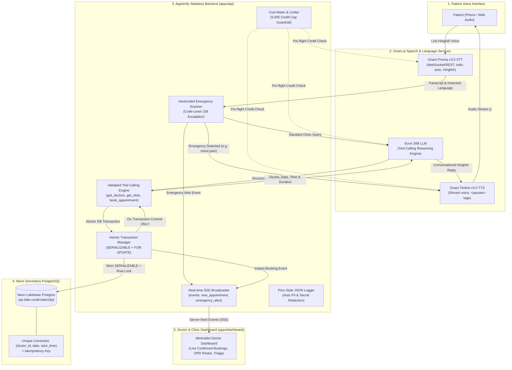

# Appointly System Architecture & Master Context

> **Hinglish Live Voice Agent for Small Clinics**  
> _Zero Double-Booking Guarantee on Neon PostgreSQL & Gnani Voice AI_

---

## 1. High-Level Architecture Diagram



---

## 2. Non-Negotiable Architectural Rules

### Rule 1: The LLM Never Writes to the Database

The Large Language Model (Evon 30B) has **zero direct access** to SQL, connections, or write tables. It can only emit structured tool calls (`get_clinic_doctors`, `get_available_slots`, `book_appointment`). All arguments are parsed and validated via Zod schemas before being handed to the database transaction manager.

### Rule 2: Zero Double-Booking Guarantee

1. **Relational Database Engine as Single Source of Truth**:
   - `CONSTRAINT uq_doctor_appointment_slot UNIQUE (doctor_id, appointment_date, start_time)`
   - `idempotency_key VARCHAR(128) NOT NULL UNIQUE`
2. **Transaction Isolation**:
   - Executed under `SERIALIZABLE` isolation with row-level locking (`SELECT ... FOR UPDATE`).
   - If two concurrent patients request the exact same slot at the exact same millisecond, one commits successfully and the second is safely rolled back with `SLOT_ALREADY_BOOKED`.
3. **Commit Before Confirmation**:
   - The voice agent says "Aapka appointment confirm ho gaya hai" **only after** the transaction has committed.

### Rule 3: Fail-Fast Startup & Secret Isolation

- Environment variables are validated on boot using Zod (`apps/api/src/config/env.ts`).
- If required keys are missing or malformed, the process exits immediately with an actionable diagnostic message.
- Secrets (`GNANI_API_KEY`, `EVON_API_KEY`, `DATABASE_URL`) are strictly isolated to the server process and are never exposed to the frontend dashboard.

### Rule 4: Hardcoded Code-Level Emergency Escalation

- Every patient utterance passes through a synchronous, deterministic regex matcher (`checkEmergency`) before reaching the LLM.
- Triggers cover cardiac distress, respiratory arrest, severe bleeding, stroke symptoms, poisoning, and loss of consciousness across Hindi, English, and Hinglish.
- If triggered, the LLM is bypassed, saving latency and token cost, and the agent immediately speaks the hardcoded 108 emergency escalation instructions.

### Rule 5: Resilience, Retries & Graceful Fallback

- Every external network call is wrapped with an `AbortController` timeout (`8,000ms`).
- Transient errors (`502/503/504`, `429`, timeouts) use exponential backoff with random jitter up to 3 retries.
- Non-retryable errors (`401 Unauthorized`, `400 Bad Request`) fail immediately.
- If retries are exhausted, the system persists a `callback_request` ticket in Neon PostgreSQL with the caller's phone number and apologises in Hinglish:
  > _"Maaf kijiye, hamare server me thodi takneeki samasya aa rahi hai. Maine aapka number clinic desk par note kar diya hai, hamari reception team aapse jald hi sampark karegi."_

### Rule 6: Structured JSON Logs with Strict PII Redaction

- All application events are logged as single-line JSON with ISO timestamp, `call_id`, and `request_id`.
- The sanitizer automatically:
  - Masks 10-digit Indian phone numbers (`+91 98765 43210` $\rightarrow$ `+91 ******3210`).
  - Masks patient names (`Ramesh Sharma` $\rightarrow$ `R**** S*****`).
  - Redacts sensitive keys containing `key`, `token`, `secret`, `password`, or `auth`.

### Rule 7: 5,000 Credit Budget & Cost Metering

- Appointly operates under a hard budget ceiling of 5,000 API credits.
- Hierarchical caps:
  - Total ceiling: 5,000 credits
  - Daily runaway ceiling: 2,000 credits
  - Per-call runaway ceiling: 50 credits
- Automated tests and local development run under `USE_MOCK_SERVICES=true`, preserving 100% of live credits for production demonstrations.

---

## 3. Monorepo Structure

```
appointly/
├── apps/
│   ├── api/                  # Stateless Voice AI Backend (Node.js/TypeScript)
│   │   ├── src/
│   │   │   ├── config/       # Fail-fast Zod environment loader
│   │   │   ├── db/           # Neon PostgreSQL client, schema.sql, transactional memory DB
│   │   │   ├── logger/       # Pino-style JSON logger with PII & secret redaction
│   │   │   ├── safety/       # Code-level deterministic emergency triage
│   │   │   ├── cost/         # 5,000 credit budget meter and limiters
│   │   │   ├── services/     # Gnani Prisma STT, Timbre TTS, Evon 30B LLM clients
│   │   │   ├── utils/        # Retry, backoff, timeout, and fallback engine
│   │   │   └── index.ts      # HTTP REST, /healthz, /readyz, SSE, graceful shutdown
│   │   └── tests/            # Vitest unit test suite (34 tests)
│   └── dashboard/            # Minimalist Doctor Dashboard (HTML5, CSS3, Live SSE)
│       ├── public/           # Appointly Logo
│       └── index.html        # Real-time appointments stream, OPD roster & voice simulator
├── packages/
│   └── shared/               # Shared domain models, Zod schemas, clinic constants
├── .github/
│   └── workflows/ci.yml      # CI workflow (lint, typecheck, test, audit, gitleaks)
├── Makefile                  # Developer workflow targets (install, dev, test, build, lint)
├── neon.ts                   # Neon branch policy and configuration
└── README.md                 # Setup and run instructions
```
